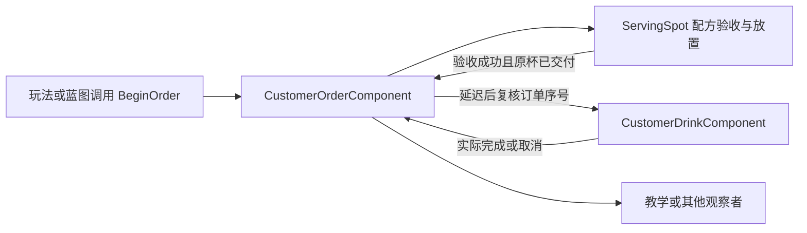

# 顾客订单与教学解耦：第一阶段

后续更新：本文件记录第一阶段；五点重构的当前结果与统一验收入口见 [RefactorAcceptance.md](RefactorAcceptance.md)。下文“下一阶段”所述工作现已纳入后续重构。

本轮改变了内部调用关系，尚未拆分全部容器职责，也没有接入 AI 或修改二进制资源。

## 运行流程

`UCustomerOrderComponent` 可以放在带 `UCustomerDrinkComponent` 的 Actor 上，不依赖 Tutorial、Narrative 或特定 NPC 类。



- `BeginOrder(Spot, Recipe, TastingDelay)` 申请出品点、设置订单并监听本地验收。失败返回 false；不会覆盖其他组件已占用的出品点。
- 状态：`Idle → AwaitingDrink → PendingTasting → Tasting → Completed`，失败与取消分别进入 `Failed` / `Cancelled`。
- 成功交付后，订单组件自行调度品尝；没有教学导演也能完成。不在 ServingSpot 的提交回调内部直接开始动作，即使延迟为零也等下一 Tick。
- 开始品尝时复核原订单序号，实际动作仍由现有顾客组件检查原杯、冻结状态、骨骼及轨迹。旧订单不能驱动新订单的杯子。
- `CancelOrder()` 取消待启动定时器，或取消自己已经启动的动作；未交付的当前订单停止接收。不会解冻、销毁或重建已交付的杯子。取消事件保留实际已消费毫升数。
- `OnTastingFinished(Cup, bCompleted, ConsumedML)` 是品尝的终态通知。原有 `CustomerDrink.OnDrinkEnded` 继续保留。

现阶段仍是一位顾客对应一个在途订单；再次接单需要明确取消/结束原订单，并由玩法处理上杯移走及出品点复位。不是完整的排队经营系统。

## 教学兼容方式

`ATutorialNPC` 增加原生 `CustomerOrder` 子组件，现有类名和 `CustomerDrink` 子对象名保留。完整保存地图测试验证旧地图加载后有新组件，不要求重存地图。

`WaitForServe` 是兼容适配层：对于启用喝饮的 NPC，它用已保存的 Spot、Recipe 和 CheerDuration 启动订单；对于未启用的旧 NPC，保留原流程。正常进入下一步不会取消已接收的订单；跳过、重启或销毁导演走独立的 `CancelStep()`，清理教学创建的动作。

`ConsumeServedDrink` 观察订单结果，能够等待尚未开始、正在执行或已经结束的品尝。旧地图直接进入 Consume 的路径仍可用；通过杯子的 AttachParent 找到出品点，不再遍历世界猜测所属订单。

导演只读取 Step 的 `WaitForCompletionPresentation()`，不再识别 WaitForServe/Consume 类型组合，也不直接安排顾客动作。独立订单的完成不受 HUD 文字被覆盖影响。对教学自己创建的订单，Skip 仍会取消品尝，保留原有交互约定。

教学仍然负责 UI 提示、订单全息屏与旧配方恢复的兼容处理。它不是完全被动的观察层；后续场景配置迁移后可再逐步缩小适配层。

## 基线问题与验证

先运行未改变业务实现的基线，补齐 `DRINK_FIX_RUN_DIR` 后：完整地图 3 项通过，其余 7 项失败。原失败日志没有证明生产流程损坏。

六个原生 Cup01 动作测试加载了已变为 Highball 加冰要求的正式 `DA_Latte`，导致配方前置验收失败。现在使用独立内存配方检验动作/取消和液体账本，正式冰拿铁要求保持原样。旧保存 NPC 测试改用完整地图夹具，保留测试名称，验证当前真实 Highball、缩放、冰要求与动作配置，而非把旧 Cup01 动作套到当前保存 NPC。

新增无教学导演的回归：真实出品后自动品尝并结束、待启动时取消、中途取消、订单序号失效，以及第二个订单争抢同一出品点。原有主关卡与回调重入测试继续保留。

可从项目根目录运行：

```powershell
./Tools/Test-CustomerFlow.ps1
```

默认跑 Customer、SceneMusic、Recipe 三组。UE5.6 命令行以 `+` 合并过滤条件；脚本设置诊断目录、输出时间戳报告，并读取 JSON 中的失败数量，避免把进程退出码 0 误当成测试通过。默认引擎位置为 `F:/UnrealEngine`，可以通过 `-EngineRoot` 修改。

报告保存在 `Saved/ArchitectureAudit/CustomerFlow-*/Tests/index.json`，完整地图测量保存在同一次运行的 `Measurements`。这是无头验证，不能代替头显中检查动作、声音、抓取手感和视觉表现。

2026-11-16 最终验证：`CyberCafeEditor Win64 Development` 编译通过；`CustomerFlow-20261116-004406` 的三组测试合计 **26 项通过、0 失败、0 未运行**。通过项包含无头环境警告，具体内容保留在报告；未宣称头显或打包验证通过。

## 下一阶段

下一步将解除 LiquidContainer 对 CustomerDrink 的反向依赖：把顾客专用字段收回行为组件，让容器通过通用占用/消耗接口维护液体守恒。随后再拆液体表现、动作硬编码和编辑器辅助代码，分批建立各自的回归边界。
